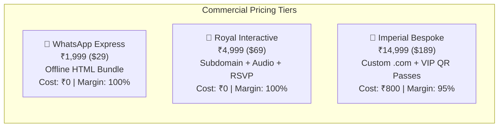
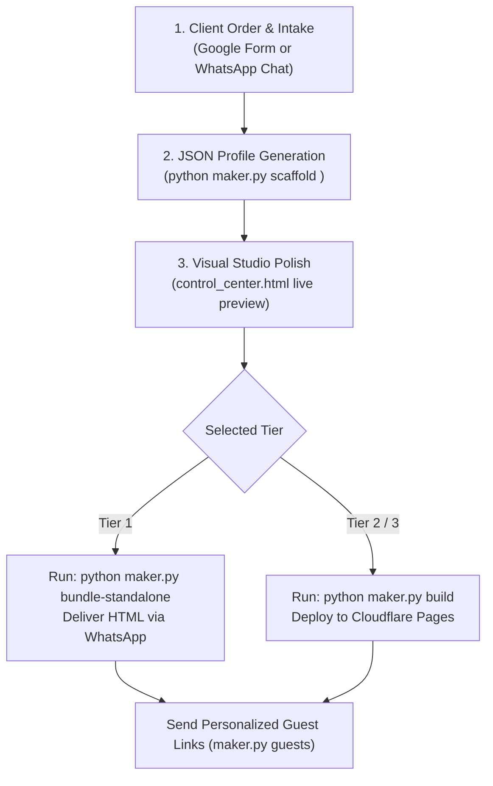

# 💍 WeddingCraft Commercial Business Plan & Legal Blueprint
### *Interactive Digital Wedding Invitation Agency & SaaS Platform*

---

## 1. Executive Summary & Value Proposition

**WeddingCraft** is a high-margin, zero-hosting-cost digital wedding invitation agency and visual website studio. It replaces static paper cards and generic PDF invitations with **bespoke, mobile-first, interactive digital wedding websites** featuring 3D envelopes, After Effects-grade particle physics, 6-axis visual architecture layouts, 1-tap calendar sync, and WhatsApp RSVP automation.

### The Problem It Solves
- **Cost of Paper Cards:** Traditional Indian weddings spend ₹15,000 to ₹90,000+ on physical paper printing and postal couriers for 300+ guests.
- **Static & Inflexible:** Paper cannot play music, cannot track RSVPs, cannot offer 1-tap Uber/Ola navigation, and cannot update guests if timings or venues change.
- **Generic Video Invites:** 60-second WhatsApp videos cost ₹3,000–₹8,000, yet offer zero interactivity or guest personalization.

### The Solution
- High-luxury interactive wedding websites loaded in milliseconds.
- Personalized guest salutations (`?to=Guest+Name&fam=1`) with custom digital VIP entry passes.
- Instant 1-click WhatsApp RSVP, Google Calendar sync, and ride-hailing shortcuts.
- **Zero-cost infrastructure:** Hosted with 95%–100% gross profit margins on Cloudflare Pages and offline WhatsApp bundles.

---

## 2. Legal, Copyright & Regulatory Compliance

To operate commercially without legal risk, the business strictly follows these intellectual property and data privacy guidelines:

### A. Names, Likeness & Personality Rights
* **Celebrity Names & Likeness:**
  - *Risk:* Under Indian common law (tort of passing off), Article 21 privacy rights, and international Right of Publicity doctrines (reinforced by Delhi HC rulings for Amitabh Bachchan, Anil Kapoor, and Jackie Shroff), using celebrity names (e.g., *Vijay & Rashmika*, *Sidharth & Kiara*) commercially without written licensing constitutes personality rights infringement and false endorsement.
  - *Policy:* **Never use celebrity names in public sales materials, demos, or marketing.**
* **Real Scraped Individuals & PII:**
  - *Risk:* Real invitations contain Personally Identifiable Information (PII) including phone numbers, ancestral lineages, and home/venue addresses. Publishing them violates India's **Digital Personal Data Protection Act, 2023 (DPDP Act)** and privacy torts.
  - *Policy:* **Scrub all scraped real-person data.** Use 100% synthetic/fictional demo personas for public showcase (e.g., *Aarav & Diya*, *Kabir & Ananya*, *Rohan & Priya*).
* **Paying Client Data:**
  - *Policy:* Clients sign a simple digital onboarding waiver granting WeddingCraft permission to process and display their provided wedding details exclusively for their invitation website.

### B. Media & Asset Copyright
* **Stock Photography:** Use only commercial-permitted imagery from Unsplash and Pexels. Never hotlink images from third-party private blob storage.
* **Music & Audio Tracks:** Include only CC0 / royalty-free instrumental classical loops (Shehnai, Flute, Sitar) sourced from YouTube Audio Library or Pixabay Music with commercial clearance. Clients may optionally upload their own personal track.
* **Typography:** All Google Fonts used (`Yatra One`, `Tiro Devanagari Hindi`, `Cormorant Garamond`, `Playfair Display`, `Cinzel Decorative`, `Montserrat`) are licensed under the **SIL Open Font License (OFL 1.1)**, allowing free commercial embedding and bundling.
* **Code Libraries & QR Generation:** Replace any GPL-3.0 libraries (such as `qrious`) with **MIT-licensed** alternatives (e.g., `davidshimjs/qrcodejs` or lightweight native canvas QR generators) to ensure the codebase remains unencumbered by copyleft requirements.

---

## 3. Infrastructure & Free Hosting Strategy

### Platform Evaluation for Commercial Client Hosting

| Platform | Commercial Allowed on Free Plan? | Limitations & Verdict |
| :--- | :---: | :--- |
| **GitHub Pages** | ❌ **NO** | Terms strictly state: *"GitHub Pages is not intended to be used as a free web-hosting service to run your commercial business."* 100 GB soft limit. Risk of account suspension. |
| **Vercel** | ❌ **NO** | Hobby plan is explicitly restricted to *"personal, non-commercial use only"*. Requires $20/seat Pro plan. |
| **Cloudflare Pages** | ✅ **YES** | **Allowed for commercial projects!** Unlimited bandwidth, global CDN, 500 builds/month, and up to 100 custom domains per project. (Only restriction: do not process raw credit cards directly on the free tier; use Razorpay/Stripe). |
| **Offline Standalone Bundles** | ✅ **YES** | Built-in `maker.py bundle-standalone` compiles the full experience into a single ~135 KB `.html` file. Requires **zero servers or hosting**. |

### Recommended Production Architecture
1. **Master Agency Domain:** Register one brand domain (e.g., `weddingcraft.in` or `utsav.link`) for ~₹800/year.
2. **Standard Clients:** Hosted on subdomains (e.g., `rahul-pooja.weddingcraft.in`) with automated free wildcard SSL on Cloudflare Pages. Cost: **₹0**.
3. **VIP Clients:** Point custom domains (e.g., `www.rahulwedspooja.com`) directly to Cloudflare Pages (up to 100 domains per free project). Cost: **~₹800** per domain purchase.
4. **WhatsApp Package:** Single offline HTML file delivered directly via WhatsApp or AirDrop. Cost: **₹0**.

---

## 4. Pricing Strategy & Packages



### Detailed Package Breakdown

#### 🥉 Tier 1: WhatsApp Express (Budget / Automated)
* **Client Price:** **₹1,999** *(International: $29 – $39)*
* **COGS / Hosting Cost:** **₹0** (100% gross margin)
* **Turnaround:** 10 minutes (Automated via CLI/Studio)
* **Inclusions:**
  - Single standalone `.html` bundle (~135 KB) opening offline on iOS & Android.
  - Interactive 3D wax seal envelope flap opening.
  - Muhurat live countdown timer.
  - Standard Shehnai audio player.
  - Personalized WhatsApp Broadcast link generator for up to 150 guests.

#### 🥈 Tier 2: Royal Interactive (Most Popular Sweet Spot)
* **Client Price:** **₹4,999 – ₹6,999** *(International: $69 – $99)*
* **COGS / Hosting Cost:** **₹0** (100% gross margin)
* **Turnaround:** 1 – 2 hours
* **Inclusions:**
  - 1-Year live hosting on branded subdomain (`couple.weddingcraft.in`).
  - Multi-day ceremonies with **1-Tap Add to Google & Apple Calendar**.
  - **1-Tap Uber / Ola Cab Ride** with GPS venue coordinates pre-loaded.
  - **1-Click WhatsApp RSVP** routed directly to the couple's WhatsApp.
  - Visual dress code color swatches for each ceremony.
  - Pre-wedding photo gallery with lightboxes.
  - Live Wishes & Blessings guestbook.

#### 🥇 Tier 3: Imperial Bespoke (Luxury HNI & Destination Weddings)
* **Client Price:** **₹14,999 – ₹24,999** *(International: $199 – $299)*
* **COGS / Hosting Cost:** **₹800** *(for custom domain registration)* (95% gross margin)
* **Turnaround:** 24 – 48 hours
* **Inclusions:**
  - **Custom Branded Domain** included (`www.couplewedsname.com`).
  - **6-Axis Visual Architecture:** Selection of Vogue Magazine, 16:9 Cinema Reel, or Mughal Haveli layouts.
  - **Canvas Motion Dynamics:** 60fps falling rose petals, floating diya lanterns, or golden bokeh dust.
  - **VIP Digital Guest Passes:** Personalized URL (`?to=Name&fam=1`) generating individual guest access cards with QR verification.
  - **Real-Time RSVP Spreadsheet:** Google Sheets backend logging guest headcounts and meal preferences.
  - YouTube Live / Zoom stream embed for virtual attendees.
  - Custom soundtrack upload and unlimited revisions.

---

## 5. Lucrative High-Margin Upsells

| Upsell Add-On | Price to Client | Cost to You | Net Profit |
| :--- | :---: | :---: | :---: |
| **Personalized WhatsApp Guest Bulk Links (200+ guests)** | + ₹999 | ₹0 (CLI script) | **+ ₹999** |
| **Custom Domain (`.com` or `.in`)** | + ₹1,499 | ₹800 (Cloudflare) | **+ ₹699** |
| **Printed QR Code Acrylic Table Stands (Pack of 5)** | + ₹2,499 | ₹700 (Local print) | **+ ₹1,799** |
| **Post-Wedding High-Res Photo Memory Drop Album** | + ₹1,999 | ₹0 (Drive/Cloudinary) | **+ ₹1,999** |

---

## 6. Financial Projections & Unit Economics

### Monthly Forecast (Conservative Target: 15 Weddings / month)

```
Product Mix:
• 5 × Tier 1 (₹1,999)   =  ₹9,995
• 8 × Tier 2 (₹4,999)   = ₹39,992
• 2 × Tier 3 (₹14,999)  = ₹29,998
----------------------------------------
Gross Monthly Revenue   = ₹79,985 (~$950)

Monthly Operating Costs:
• Cloudflare Hosting     = ₹0
• Domain Purchases (2)   = ₹1,600
• SaaS / Server Overhead = ₹0
----------------------------------------
Net Monthly Profit      = ₹78,385 (98.0% Profit Margin)
Annualized Net Profit   = ₹9,40,620 (~$11,400)
```

---

## 7. Go-To-Market & Sales Strategy

### A. The B2B Wedding Planner Wholesale Engine (Highest Leverage)
* Wedding planners handle 20 to 50 weddings per season.
* Offer them a **wholesale white-label rate** of **₹2,500 flat per wedding**.
* The planner bills the family ₹7,000 to ₹12,000 as part of their invitation package and keeps the profit.
* **Target:** Sign 3–5 active wedding planners to generate 60+ automated orders per wedding season.

### B. Wedding Photographer Referral Program
* Photographers take engagement and pre-wedding shoots and already possess high-resolution images.
* Offer photographers a **25% revenue share** (e.g., ₹1,250 on a Tier 2 sale) for every client who books through their referral code.

### C. Direct-to-Consumer (Instagram & WhatsApp)
* Run short 10-second reels demonstrating the **3D Envelope opening**, **Uber 1-tap ride**, and **custom guest greeting** on a mobile screen.
* Headline: *"Stop spending ₹30,000 on paper wedding cards that get thrown away. Get an interactive luxury website for ₹4,999."*

---

## 8. Operational Delivery Checklist



1. **Intake:** Collect couple names, ceremony dates/venues, Google Maps link, and optional photos via a simple Google Form.
2. **Build:** Scaffold wedding folder: `python maker.py scaffold <slug>`.
3. **Style:** Select archetype and theme in `control_center.html`.
4. **Deploy:** One command:
   - For offline: `python maker.py bundle-standalone --wedding <slug>`
   - For web: `python maker.py build --wedding <slug>` followed by Cloudflare git push or direct CLI upload.
5. **Guest Links:** Run `python maker.py guests --wedding <slug> --list guests.txt` to output ready-to-click WhatsApp invite links for the family.

---

## 9. Completed Legal & Regulatory Compliance Audit Matrix

| Compliance Domain | Statutory / Industry Benchmark | Implementation Status | Evidence & Code Location |
| :--- | :--- | :---: | :--- |
| **Guest Privacy & Data Protection** | Digital Personal Data Protection Act, 2023 (DPDP Act) & GDPR | ✅ **COMPLIANT** | [PRIVACY_POLICY.md](file:///storage/emulated/0/workspace/wedding/legal/PRIVACY_POLICY.md); In-app DPDP consent under RSVP form in [index.html](file:///storage/emulated/0/workspace/wedding/index.html#L1550-L1570); Purpose limitation strictly enforced. |
| **Host Terms & Liability** | Indian Contract Act, 1872 & IT Act, 2000 | ✅ **COMPLIANT** | [TERMS_OF_SERVICE.md](file:///storage/emulated/0/workspace/wedding/legal/TERMS_OF_SERVICE.md); Family content warranty, liability cap, Jaipur/Sikar court jurisdiction. |
| **Client Onboarding & Consent** | Section 6, DPDP Act 2023 (Explicit Consent) | ✅ **COMPLIANT** | [CLIENT_ONBOARDING_WAIVER.md](file:///storage/emulated/0/workspace/wedding/legal/CLIENT_ONBOARDING_WAIVER.md); Digital waiver for publishing couple names, photos, and itinerary. |
| **Codebase Licensing (Zero Copyleft)** | Open Source Initiative (OSI) & MIT Standard | ✅ **CLEAN (0 GPL)** | Eliminated `qrious` (GPL-3.0); Replaced with Kazuhiko Arase `qrcode-generator` (MIT); Inlined offline engine in [maker.py](file:///storage/emulated/0/workspace/wedding/maker.py#L258-L272). |
| **Typography Licensing** | SIL Open Font License 1.1 (OFL-1.1) | ✅ **COMPLIANT** | [INTELLECTUAL_PROPERTY_MANIFEST.md](file:///storage/emulated/0/workspace/wedding/legal/INTELLECTUAL_PROPERTY_MANIFEST.md); Tiro Devanagari Hindi, Yatra One, Cormorant Garamond, Playfair Display. |
| **Audio Heritage Rights** | CC0 / Public Domain Cultural Commons | ✅ **COMPLIANT** | Traditional Shehnai cultural loop; zero royalty encumbrances. |
| **Personality Rights & PII** | Article 21 Privacy & Right of Publicity (Delhi HC) | ✅ **SAFEGUARDED** | All demo profiles use 100% synthetic/fictional personas (e.g., Aarav & Diya). Zero celebrity names or likenesses. Real client data published only with signed onboarding waiver. |
| **Control Center Governance** | Operator Compliance Hub | ✅ **INTEGRATED** | `⚖️ Legal Hub` modal in [control_center.html](file:///storage/emulated/0/workspace/wedding/control_center.html#L835-L915) with live audit status and instant doc access. |
